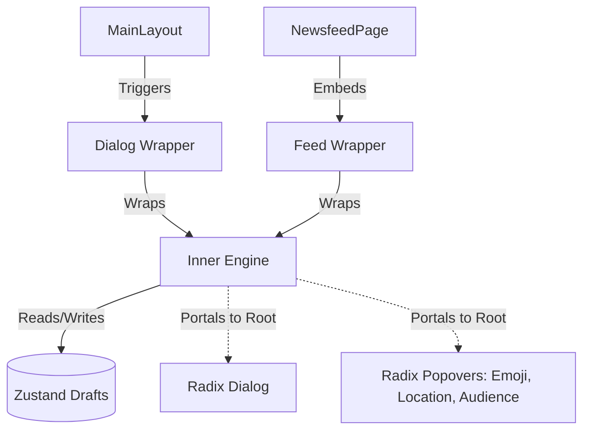

# 1. ARCHITECTURE & DATA FLOW

## 1.1 Component Tree

## 1.2 Zustand Store (`post-draft-store.ts`)

- **State:** `PostDraft { id, content, images[], audience, updatedAt }`
- **Actions:** `saveDraft(content, images, audience, id?)`, `deleteDraft(id)`, `clearDrafts()`

---

# 2. UI/UX IMPLEMENTATION RULES

## 2.1 Text Input & Auto-Grow

- Borderless `<textarea>` wrapped in `react-hook-form`.
- Dynamic height matching content lines (Max `250px`, then scroll).
- Visual ring & counter: `length / 500`.

## 2.2 Image Gallery & Upload (Memory-Safe)

- **Upload:** Use `<input type="file" multiple accept="image/*" />`.
- **Preview:** Map via `URL.createObjectURL`. **MUST** call `URL.revokeObjectURL` on unmount to prevent memory leaks.
- **Scroll Handlers:**
    - *Grab-Drag:* Map `onMouseDown`, `onMouseMove`, `onMouseUp` to `scrollLeft`.
    - *Shift-Scroll:* Map `onWheel` (`e.deltaY` + `Shift` -> `scrollLeft`).

- **UI:** Rounded previews in horizontal bar, absolute 'X' overlay to remove.

## 2.3 Radix UI Popovers (Portaled)

**Rule:** MUST use new `ui/popover.tsx` (wraps radix-ui) with `<PopoverPortal>` to avoid Z-index/overflow issues. Apply `avoidCollisions` & `collisionPadding`.

- **Audience:** 4 options (Anyone 🌐, Followers 👥, Following 👤, Mention 🏷️).
- **Mentions:** Triggered by `@` + chars. Replaces text with `@username` & restores textarea focus.
- **Emoji & GIF:** Large layout, Search bar, Categorized groups.
- **Location:** Locked `h-12`, high-end hover. "Clear Location" button placed *outside* the scrollable results list.

---

# 3. ESCAPE SHIELD & DRAFT LOGIC

**Condition:** If `content.trim().length > 0` or `images.length > 0` (Form is dirty).

## 3.1 The `Escape` Key Hierarchy

1. **Sub-Popover Shield:** If any popover (Emoji, GIF, Mention, Audience) is open, `Escape` **ONLY** closes that popover. Do not trigger discard warnings.
2. **If all sub-popovers are closed:**
- **In `PostCreatorFeed`:** Auto-trigger `handleInlineEscape` -> Save to draft, clear form state, blur focus.
- **In `PostCreatorDialog`:** Intercept close -> Open `DiscardWarningDialog`.

## 3.2 DiscardWarningDialog (`discard-warning-dialog.tsx`)

Rendered at root DOM via Radix `<DialogPortal>`. Contains 3 actions:

- **Save to Drafts:** Call `saveDraft(...)`, clear input, close creator.
- **Discard:** Clear state/revoke URLs, close creator.
- **Cancel:** Close warning, restore textarea focus.

---

# 4. VERIFICATION (Backlog)

- [ ] **Type Check:** `npm run build` throws zero TS/Turbopack errors.
- [ ] **Memory:** Confirm `URL.revokeObjectURL` fires when closing Post Creator with unsaved images.
- [ ] **UX (Feed):** Pressing `ESC` while typing in the inline feed auto-saves to draft without confirmation.
- [ ] **UX (Dialog):** Pressing `ESC` with Emoji popover open *only* closes the Emoji popover.
- [ ] **UI:** Popovers properly flip (avoid collisions) near screen edges on Mobile.
