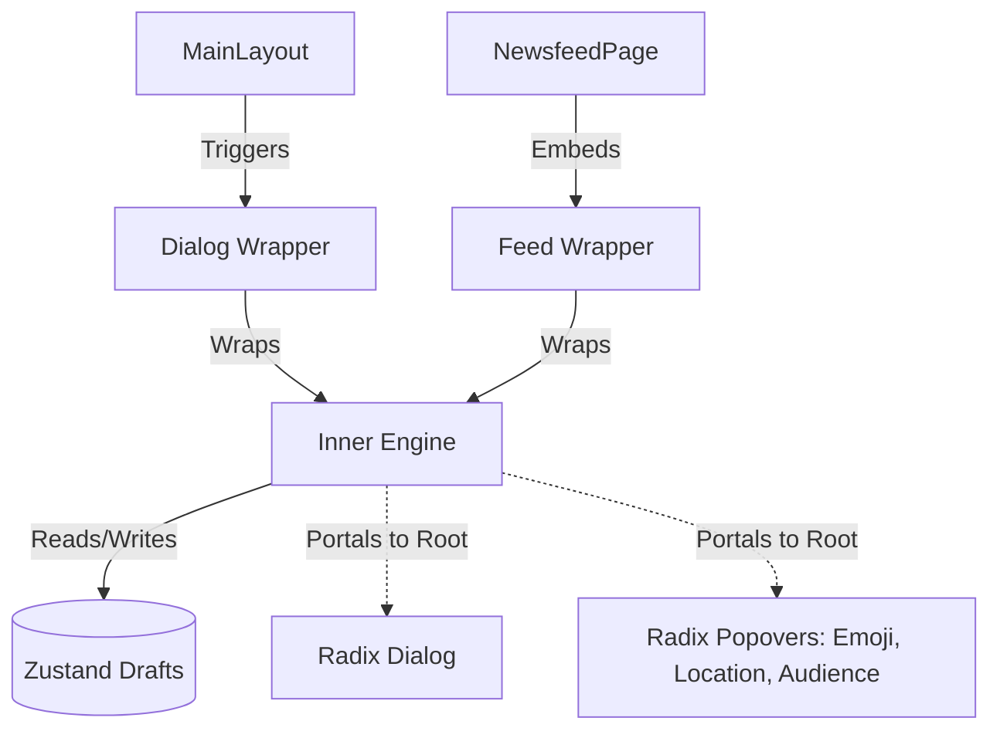

# 0. REAL vs MOCK MODE

Post creation hits real BE by default (`createPost` -> `post-service.real.ts`, `NEXT_PUBLIC_REAL_API_SLICES` unset). BE has media upload (D33, `features/media.md`) but no post audience, so composer is trimmed via `src/lib/capabilities.ts` (`hasCapability`, read per render). Mock mode (`none`) keeps full composer

| Control | Real (`content` real) | Mock |
|---|---|---|
| Local file upload (`multiImage` + `mediaUpload`) | shown in post mode (hidden in reply mode): images & videos uploaded through `useMediaUploadQueue`, submit sends `mediaIds` | shown, multiple images as blob previews |
| GIF picker | shown in post mode, hidden in reply mode; external GIF = `imageUrl`, never together with `mediaIds` (`createPost` drops it when media ids exist) | shown, also in replies |
| Audience + Close friends toggle (`postAudience`) | hidden; `audience` / `visibility` are not sent | shown (post mode) |
| Drafts picker | shown in post mode (not capability-gated); restoring draft resets audience to `anyone` & visibility to `public` | shown; restore keeps draft audience / visibility |
| Emoji, Location, Mention | shown; static mock lists (see 2.3), location is never sent | same |

Reply mode (`mode="reply"`): no audience, no drafts; `createReply` sends text only (`POST comments`)

# 1. ARCHITECTURE & DATA FLOW

## 1.1 Component Tree

## 1.2 Zustand Store (`post-draft-store.ts`)
- **State:** `PostDraft { id, content, images[], audience, visibility?, createdAt }`; drafts persisted to `localStorage` key `ysocial_post_drafts`
- **Actions:** `saveDraft(content, images, audience, id?, visibility?)` (returns id), `deleteDraft(id)`, `clearDrafts()`

---

# 2. UI/UX RULES

## 2.1 Text Input & Auto-Grow
- Borderless `<textarea>` wrapped in `react-hook-form`
- Height grows with content lines (max `250px`, then scroll)
- Visual ring & counter: `length / 500`

## 2.2 Image Gallery & Upload (Memory-Safe)
- **Upload:** real BE = queue (`accept` = BE types, previews with progress/error/retry/remove, submit blocked while busy or failed, `onPostSubmitted(..., mediaIds)` as OPTIONAL 5th arg only when non-empty, close/discard gives assets back, drafts keep NO media); mock mode only: `<input type="file" multiple accept="image/*" />`
- **Preview:** map via `URL.createObjectURL`. MUST call `URL.revokeObjectURL` on unmount to prevent memory leaks
- **Scroll handlers:**
  - **Grab-drag:** `onMouseDown`, `onMouseMove`, `onMouseUp` -> `scrollLeft`
  - **Shift-scroll:** `onWheel` (`e.deltaY` + `Shift` -> `scrollLeft`)
- **UI:** rounded previews in horizontal bar, absolute 'X' overlay to remove

## 2.3 Radix UI Popovers (Portaled)
- MUST use new `ui/popover.tsx` (wraps radix-ui) with `<PopoverPortal>` to avoid Z-index/overflow issues. Apply `avoidCollisions` & `collisionPadding`
- **Audience (mock mode only, `postAudience`):** 4 options (Anyone, Followers, Following, Mention) = who can reply; plus a separate Close friends toggle (`visibility`, signed-in author, post mode)
- **Mentions:** triggered by `@` + chars. Candidates come from hardcoded list of 4 mock profiles (`SUGGESTED_PROFILES`), not from user search. Replaces text with `@username` & restores textarea focus
- **Emoji & GIF:** large layout, search bar, categorized groups; emoji, GIF (static giphy URLs) & location lists are hardcoded mocks
- **Location:** locked `h-12`, high-end hover. "Clear Location" button placed *outside* scrollable results list

---

# 3. ESCAPE SHIELD & DRAFT LOGIC

**Dirty condition:** `content.trim().length > 0 || images.length > 0 || queue.items.length > 0` (a media-only post is valid)

## 3.1 `Escape` Key Hierarchy
1. **Sub-popover shield:** IF any popover (Emoji, GIF, Mention, Location, Audience, Drafts) open -> `Escape` ONLY closes that popover. NEVER trigger discard warning
2. **IF all sub-popovers closed:**
   - `PostCreatorFeed`: global `Escape` calls `handleInlineEscape`; only acts when textarea is focused: dirty -> open `DiscardWarningDialog`, clean -> blur
   - `PostCreatorDialog`: intercept close -> open `DiscardWarningDialog`

## 3.2 `DiscardWarningDialog` (`discard-warning-dialog.tsx`)
Rendered at root DOM via Radix `<DialogPortal>`. 3 actions:
- **Save to Drafts:** call `saveDraft(...)`, clear input, close creator
- **Discard:** clear state/revoke URLs, close creator
- **Cancel:** close warning only (focus restore not verified in code)

---

# 4. VERIFICATION (Backlog)

- [ ] **Type Check:** `npm run build` -> zero TS/Turbopack errors
- [ ] **Memory:** `URL.revokeObjectURL` fires when closing Post Creator with unsaved images
- [ ] **UX (Feed):** `ESC` while typing in inline feed (dirty form) opens `DiscardWarningDialog`
- [ ] **UX (Dialog):** `ESC` with Emoji popover open ONLY closes Emoji popover
- [ ] **UI:** Popovers flip (avoid collisions) near screen edges on mobile
