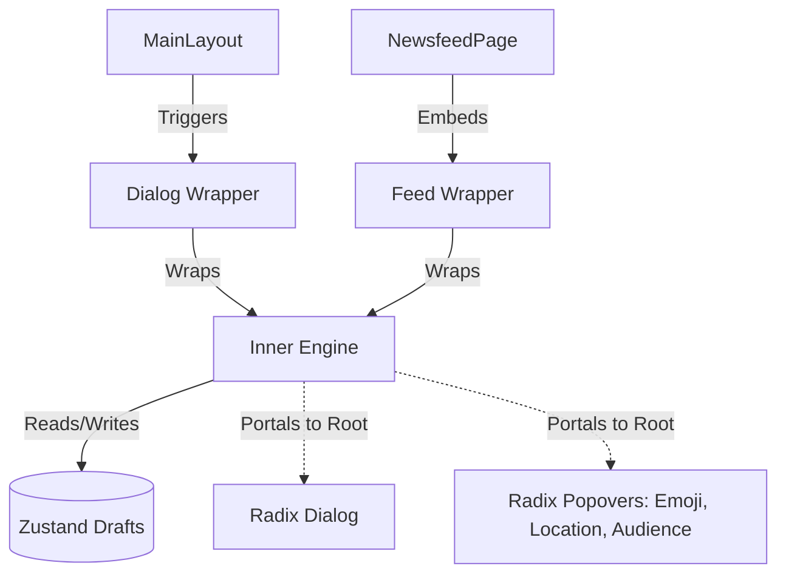

# 1. ARCHITECTURE & DATA FLOW

## 1.1 Component Tree

## 1.2 Zustand Store (`post-draft-store.ts`)
- **State:** `PostDraft { id, content, images[], audience, updatedAt }`
- **Actions:** `saveDraft(content, images, audience, id?)`, `deleteDraft(id)`, `clearDrafts()`

---

# 2. UI/UX RULES

## 2.1 Text Input & Auto-Grow
- Borderless `<textarea>` wrapped in `react-hook-form`
- Height grows with content lines (max `250px`, then scroll)
- Visual ring & counter: `length / 500`

## 2.2 Image Gallery & Upload (Memory-Safe)
- **Upload:** `<input type="file" multiple accept="image/*" />`
- **Preview:** map via `URL.createObjectURL`. MUST call `URL.revokeObjectURL` on unmount to prevent memory leaks
- **Scroll handlers:**
  - **Grab-drag:** `onMouseDown`, `onMouseMove`, `onMouseUp` -> `scrollLeft`
  - **Shift-scroll:** `onWheel` (`e.deltaY` + `Shift` -> `scrollLeft`)
- **UI:** rounded previews in horizontal bar, absolute 'X' overlay to remove

## 2.3 Radix UI Popovers (Portaled)
- MUST use new `ui/popover.tsx` (wraps radix-ui) with `<PopoverPortal>` to avoid Z-index/overflow issues. Apply `avoidCollisions` & `collisionPadding`
- **Audience:** 4 options (Anyone 🌐, Followers 👥, Following 👤, Mention 🏷️)
- **Mentions:** triggered by `@` + chars. Replaces text with `@username` & restores textarea focus
- **Emoji & GIF:** large layout, search bar, categorized groups
- **Location:** locked `h-12`, high-end hover. "Clear Location" button placed *outside* scrollable results list

---

# 3. ESCAPE SHIELD & DRAFT LOGIC

**Dirty condition:** `content.trim().length > 0 || images.length > 0`

## 3.1 `Escape` Key Hierarchy
1. **Sub-popover shield:** IF any popover (Emoji, GIF, Mention, Audience) open -> `Escape` ONLY closes that popover. NEVER trigger discard warning
2. **IF all sub-popovers closed:**
   - `PostCreatorFeed`: auto-trigger `handleInlineEscape` -> save to draft, clear form state, blur focus
   - `PostCreatorDialog`: intercept close -> open `DiscardWarningDialog`

## 3.2 `DiscardWarningDialog` (`discard-warning-dialog.tsx`)
Rendered at root DOM via Radix `<DialogPortal>`. 3 actions:
- **Save to Drafts:** call `saveDraft(...)`, clear input, close creator
- **Discard:** clear state/revoke URLs, close creator
- **Cancel:** close warning, restore textarea focus

---

# 4. VERIFICATION (Backlog)

- [ ] **Type Check:** `npm run build` -> zero TS/Turbopack errors
- [ ] **Memory:** `URL.revokeObjectURL` fires when closing Post Creator with unsaved images
- [ ] **UX (Feed):** `ESC` while typing in inline feed auto-saves to draft without confirmation
- [ ] **UX (Dialog):** `ESC` with Emoji popover open ONLY closes Emoji popover
- [ ] **UI:** Popovers flip (avoid collisions) near screen edges on mobile
