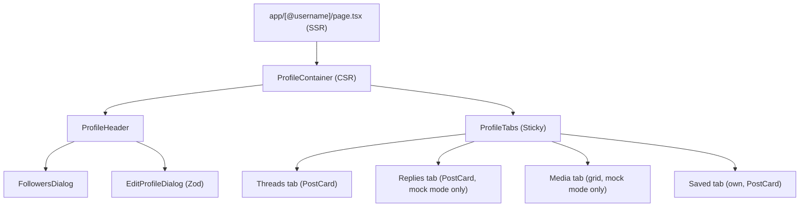

# 1. ARCHITECTURE & API CONTRACTS

## 1.1 SSR / CSR Boundary
- **SSR Entry (`app/[@username]/page.tsx`):** parses URL param (`@username`), runs `generateMetadata` for dynamic OpenGraph. Real (default): anonymous `serverApiFetch` of `users/by-username` (shared by metadata & page), only BE 404 -> `notFound()`, other failures -> `error.tsx`. Mock mode (`NEXT_PUBLIC_REAL_API_SLICES=none`): resolves from seed users + `ysocial_mock_user` cookie. Detail: `features/profile.md`
- **CSR Boundary (`ProfileContainer.tsx`):** interactive state (tabs, follower dialogs, edit modal); talks to Zustand stores + service adapters (`*.real.ts`). Also owns what anonymous server read cannot see: BE 404 for blocked-either-way profile (D14) -> not-found state

## 1.2 Component Tree

## 1.3 Endpoints & Contracts
> Single owner: `.context/backend/integration/frontend-backend-mapping.md` (endpoint matrix MAP §2.2, §2.6, `UserProfileDto` & list DTOs MAP §3, error codes MAP §1.1). Not repeated here

- **Profile read:** by id & by username (case-insensitive), anonymous allowed; blocked either way / deleted / unknown = 404 (anonymous SSR read cannot know block: only unknown/deleted become `notFound()` there, blocked is resolved by viewer's own client read); private profile = 200 with same field set (counts visible, content `locked`)
- **Follow state:** `followStatus` `none | pending | accepted` (lowercase), `isFollowing` derived; `{followStatus}` in follow response
- **Counts:** computed on read from accepted edges whose other party is discoverable to viewer (equal to follow-list totals)
- **Edit:** `PUT /api/users/profiles/me` returns updated `UserProfileDto` (no username/email/privacy); privacy has its own endpoint

---

# 2. IMPLEMENTATION RULES

## 2.1 Backend CQRS (`Features/UserRelations`, `Features/UserBlocks`, `Features/Users`)
All commands implicitly extract `ObserverId` via `IUserContext`.

### Commands & queries
- `FollowUserCommand(Guid TargetId)` -> `UserRelationManager.FollowUserAsync()`
- `UnfollowUserCommand(Guid TargetId)` -> `UserRelationManager.UnfollowUserAsync()`
- `ToggleCloseFriendCommand(Guid TargetId, bool IsCloseFriend)` -> mutates close-friend flag (only while follow is Accepted)
- `RespondFollowRequestCommand(Guid RequesterId, string Decision)` -> accept (`AcceptFollow`, notifies requester) | decline (soft-delete edge, no event)
- `UpdatePrivacyCommand(bool IsPrivate)` -> going public accepts only pending requests; returns `{acceptedCount}`
- `BlockUserCommand(Guid TargetId)` -> `UserRelationManager.BlockUserAsync()` (target must exist)
- `UnblockUserCommand(Guid TargetId)` -> removes `UserBlock` entity from repo
- Queries: `GetUserProfile*`, `GetMe`, `GetFollowList` (followers/following), `GetFollowRequests` (+ count), `GetRelationSets`, `GetBlocks`; all filtered by `IViewerAccessPolicy`, paged after filtering

### Domain & Architecture Rules
- **Aggregate segregation:** `UserBlock` = standalone Aggregate Root (separate from `UserRelation`) for fast block checks
- **Soft-delete restoration:** unfollow sets `IsDeleted = true` to preserve metadata (`IsCloseFriend`). Re-follow restores soft-deleted entity, NEVER creates duplicate record
- **Idempotency:** follow on already-followed account fails silently (returns current status, no mutation)
- **Query batching:** bidirectional block validation uses `GetBlocksBetweenAsync` (A->B & B->A in 1 query); read paths use set-based members (`GetBlockedEitherWayAsync`, `GetRelationsAsync`, ...), never per-item lookups (conventions/backend.md)
- **Blocks are total (D14):** blocked either way = 404 for every discovery, content & interaction path; own block list is only exception

### Event-Driven Pipeline (live: events dispatch in same request, BG §7)
- `UpdateFollowCountsHandler`: listens `UserFollowAcceptedEvent` / `UserUnfollowedEvent` -> mutates stored `FollowersCount` & `FollowingCount` on `User` aggregates (`Count >= 0`); stored counters are NOT exposed (API counts are computed on read)
- `RemoveFollowsWhenUserBlockedEventHandler`: listens `UserBlockedEvent` -> purges active bidirectional follow relations between both profiles
- `CreateNotificationWhenFollow*`: follow requested/accepted notifications (accepted request notifies requester)

## 2.2 Visual Spec (Luxury Minimalist Zinc)
- Name: `text-2xl font-bold tracking-tight text-zinc-900 dark:text-zinc-50`
- Username: `text-sm font-medium text-zinc-500 dark:text-zinc-400`
- Avatar: `w-20 h-20 sm:w-24 sm:h-24` + high-end border
- Counters: `text-sm text-zinc-500 hover:underline hover:text-zinc-900 dark:hover:text-zinc-100 cursor-pointer`
- Sticky tabs: `border-b border-zinc-200/60 dark:border-zinc-900/60`, smooth sticky offsets on scroll

---

# 3. SAFETY GUARDS & HYDRATION

## 3.1 Bio Link Parsing (XSS Protection)
- Parse raw bio text via native `URL` constructor
- ONLY allow `http:` & `https:`
- NEVER use `dangerouslySetInnerHTML`. Discard `javascript:` / `data:` schemes -> render as plain text nodes

## 3.2 Time-Drift Hydration Guard
- Wrap all relative timestamps in `<SafeHydration>` (`src/components/shared/safe-hydration.tsx`)
- Time calculations MUST render ONLY after client mount to avoid SSR/CSR mismatch

## 3.3 Strict 404 Routing
- IF server profile read returns `404 Not Found`, immediately call Next.js native `notFound()` inside Server Component (only 404; network / TLS / 5xx go to `error.tsx`; usernames over 30 chars are 404 without call). Block-caused 404 is shown client-side by `ProfileContainer` (`profile.blockedNotFound`)

---

# 4. VERIFICATION

- [ ] **SSR Route:** `/@anquoc.dev` renders Server Page & OG meta tags (FE; real BE by default, mock seed in mock mode)
- [ ] **404 Handling:** invalid username -> `not-found.tsx` (FE; BE answers 404 for unknown/blocked/deleted; blocked shows client not-found state)
- [ ] **XSS Shield:** bio with `javascript:alert(1)` renders as safe plain text (FE)
- [ ] **Hydration:** zero React hydration warnings on relative timestamps after reload (FE)
- [x] **BE follow contract:** `Follow_ReturnsJsonFollowStatusLowercase`, `FollowPublicUser_IncrementsCounts` (`tests/YSocial.Api.IntegrationTests`)
- [x] **BE block flow:** `Block_RemovesFollowsBothDirections_CountsInSameRequest`
- [x] **BE profile/relations suite:** `Users/ProfileReadTests`, `Relations/*` (privacy, requests, lists)
