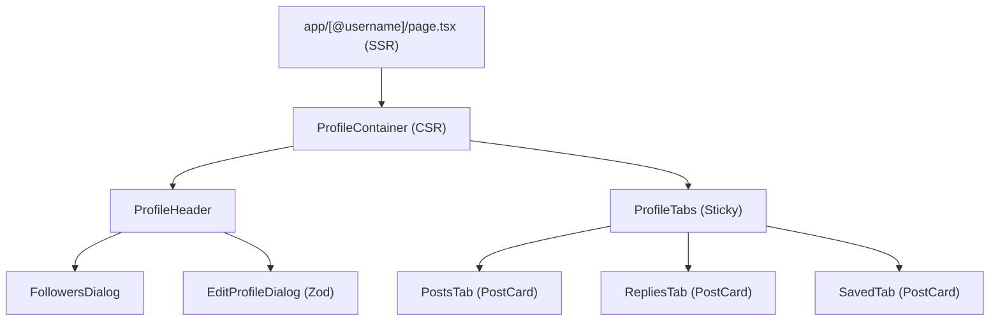

# 1. ARCHITECTURE & API CONTRACTS

## 1.1 SSR / CSR Boundary
- **SSR Entry (`app/[@username]/page.tsx`):** parses URL param (`@username`), runs `generateMetadata` for dynamic OpenGraph, fetches profile server-side, calls `notFound()` on API 404
- **CSR Boundary (`ProfileContainer.tsx`):** interactive state (tabs, follower dialogs, edit modal); talks to Zustand/TanStack Query

## 1.2 Component Tree


## 1.3 Endpoints & Contracts
| Endpoint | Payload / Result |
|---|---|
| `GET /api/users/@{username}` | -> `UserProfile` |
| `PATCH /api/users/profile` | Payload `UpdateProfileRequest` |
| `POST /api/users/{targetId}/follow` | `200 OK` + `{ followStatus: "Pending" \| "Accepted" }` |
| `DELETE /api/users/{targetId}/follow` | Unfollow target |
| `PATCH /api/users/{targetId}/close-friend` | Payload `{ isCloseFriend: boolean }` |
| `POST /api/users/{targetId}/block` | Block target |
| `DELETE /api/users/{targetId}/block` | Unblock target |

```typescript
export interface UserProfile {
  id: string;
  displayName: string;
  username: string;
  bio?: string;
  avatarUrl?: string;
  coverUrl?: string;
  followersCount: number;
  followingCount: number;
  isFollowing: boolean;
  isVerified?: boolean;
}
```

---

# 2. IMPLEMENTATION RULES

## 2.1 Backend CQRS Commands (`Features/UserRelations`)
All commands implicitly extract `ObserverId` via `IUserContext`.

### Commands
- `FollowUserCommand(Guid TargetId)` -> `UserRelationManager.FollowUserAsync()`
- `UnfollowUserCommand(Guid TargetId)` -> `UserRelationManager.UnfollowUserAsync()`
- `ToggleCloseFriendCommand(Guid TargetId, bool IsCloseFriend)` -> mutates close-friend flag
- `BlockUserCommand(Guid TargetId)` -> `UserRelationManager.BlockUserAsync()`
- `UnblockUserCommand(Guid TargetId)` -> removes `UserBlock` entity from repo

### Domain & Architecture Rules
- **Aggregate segregation:** `UserBlock` = standalone Aggregate Root (separate from `UserRelation`) for fast `AnyAsync` block checks
- **Soft-delete restoration:** unfollow sets `IsDeleted = true` to preserve metadata (`IsCloseFriend`). Re-follow restores soft-deleted entity, NEVER creates duplicate record
- **Idempotency:** follow on already-followed account fails silently (returns `Success`, no DB mutation)
- **Query batching:** bidirectional block validation uses `GetBlocksBetweenAsync` via `Task.WhenAll()` -> A->B & B->A checks in single query round-trip

### Event-Driven Pipeline
- `UpdateFollowCountsHandler`: listens `UserFollowAcceptedEvent` / `UserUnfollowedEvent` -> atomically mutates `FollowersCount` & `FollowingCount` on `User` aggregates (`Count >= 0`)
- `RemoveFollowsWhenUserBlockedEventHandler`: listens `UserBlockedEvent` -> immediately purges active bidirectional follow relations between both accounts

## 2.2 Visual Spec (Luxury Minimalist Zinc)
- Name: `text-2xl font-bold tracking-tight text-zinc-900 dark:text-zinc-50`
- Username: `text-sm font-medium text-zinc-500 dark:text-zinc-400`
- Avatar: `w-20 h-20 sm:w-24 sm:h-24` + high-end border
- Counters: `text-sm text-zinc-500 hover:underline hover:text-zinc-900 dark:hover:text-zinc-100 cursor-pointer`
- Sticky tabs: `border-b border-zinc-200/60 dark:border-zinc-900/60`, smooth sticky offsets on scroll

---

# 3. SAFETY GUARDS & HYDRATION

## 3.1 Bio Link Parsing (XSS Protection)
- Parse raw bio text via native `URL` constructor
- ONLY allow `http:` & `https:`
- NEVER use `dangerouslySetInnerHTML`. Discard `javascript:` / `data:` schemes -> render as plain text nodes

## 3.2 Time-Drift Hydration Guard
- Wrap all relative timestamps in `<SafeHydration>` (`src/components/shared/safe-hydration.tsx`)
- Time calculations MUST render ONLY after client mount to avoid SSR/CSR mismatch

## 3.3 Strict 404 Routing
- IF profile query returns `404 Not Found`, immediately call Next.js native `notFound()` inside Server Component

---

# 4. VERIFICATION (Backlog)

- [ ] **SSR Route:** `/@anquoc.dev` renders Server Page & OG meta tags
- [ ] **404 Handling:** invalid username -> `not-found.tsx`
- [ ] **XSS Shield:** bio with `javascript:alert(1)` renders as safe plain text
- [ ] **Hydration:** zero React hydration warnings on relative timestamps after reload
- [ ] **CQRS Test:** `FollowUserCommand` returns updated `FollowStatus` & updates follower counts
- [ ] **Block Flow:** blocking user immediately clears existing follow relations
