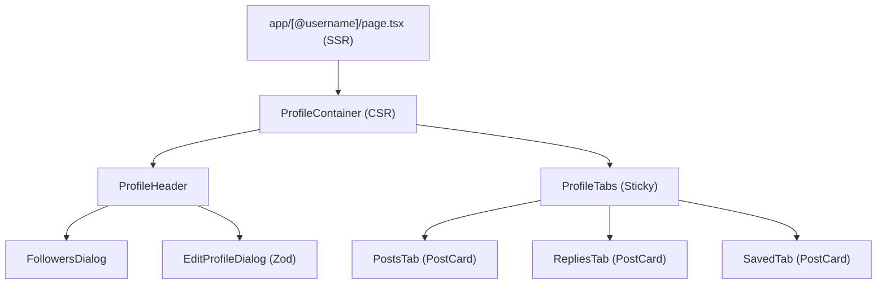

# 1. ARCHITECTURE & API CONTRACTS

## 1.1 SSR / CSR Boundary
- **SSR Entry (`app/[@username]/page.tsx`):** Handles URL parameter parsing (`@username`), triggers `generateMetadata` for dynamic OpenGraph, fetches server-side user profile data & executes `notFound()` on 404 API responses.
- **CSR Boundary (`ProfileContainer.tsx`):** Manages interactive states (tabs, follower dialogs, edit modal) & communicates with Zustand/TanStack Query.

## 1.2 Component Tree


## 1.3 Endpoints & Contracts

- **`GET /api/users/@{username}`** -> `UserProfile`
- **`PATCH /api/users/profile`** -> Payload: `UpdateProfileRequest`
- **`POST /api/users/{targetId}/follow`** -> Returns `200 OK` + `{ followStatus: "Pending" | "Accepted" }`
- **`DELETE /api/users/{targetId}/follow`** -> Unfollow target user
- **`PATCH /api/users/{targetId}/close-friend`** -> Payload: `{ isCloseFriend: boolean }`
- **`POST /api/users/{targetId}/block`** -> Block target user
- **`DELETE /api/users/{targetId}/block`** -> Unblock target user

```typescript
export interface UserProfile {
  id: string;
  displayName: string;
  username: string;
  bio?: string;
  avatarUrl?: string;
  coverUrl?: string;
  followersCount: number;
  followingCount: number;
  isFollowing: boolean;
  isVerified?: boolean;
}

```

---

# 2. IMPLEMENTATION RULES

## 2.1 Backend CQRS Commands (`Features/UserRelations`)

All commands implicitly extract `ObserverId` via `IUserContext`:

### Commands

- **`FollowUserCommand(Guid TargetId)`** -> Invokes `UserRelationManager.FollowUserAsync()`
- **`UnfollowUserCommand(Guid TargetId)`** -> Invokes `UserRelationManager.UnfollowUserAsync()`
- **`ToggleCloseFriendCommand(Guid TargetId, bool IsCloseFriend)`** -> Mutates close friend flag
- **`BlockUserCommand(Guid TargetId)`** -> Invokes `UserRelationManager.BlockUserAsync()`
- **`UnblockUserCommand(Guid TargetId)`** -> Removes `UserBlock` entity from repository

### Domain & Architectural Rules

- **Aggregate Segregation:** `UserBlock` is isolated as a standalone Aggregate Root (separate from `UserRelation`) for high-speed `AnyAsync` execution during block checks.
- **Soft-Delete Restoration:** Unfollowing sets `IsDeleted = true` to preserve metadata (`IsCloseFriend`). Re-following restores the soft-deleted entity rather than creating a duplicate record.
- **Idempotency:** Re-triggering follow on an already followed account fails silently (returns `Success` without DB mutation).
- **Query Batching:** Bidirectional block validation uses `GetBlocksBetweenAsync` via `Task.WhenAll()` to execute both A->B & B->A checks in a single query round-trip.

### Event-Driven Pipeline

- **`UpdateFollowCountsHandler`:** Listens to `UserFollowAcceptedEvent` / `UserUnfollowedEvent` to atomically mutate `FollowersCount` & `FollowingCount` on `User` aggregates (`Count >= 0`).
- **`RemoveFollowsWhenUserBlockedEventHandler`:** Listens to `UserBlockedEvent` to immediately purge active bidirectional follow relationships between both accounts.

## 2.2 Visual Spec & Styling (Luxury Minimalist Zinc)

- **Name:** `text-2xl font-bold tracking-tight text-zinc-900 dark:text-zinc-50`
- **Username:** `text-sm font-medium text-zinc-500 dark:text-zinc-400`
- **Avatar:** `w-20 h-20 sm:w-24 sm:h-24` with high-end border
- **Counters:** `text-sm text-zinc-500 hover:underline hover:text-zinc-900 dark:hover:text-zinc-100 cursor-pointer`
- **Sticky Tabs:** Border `border-b border-zinc-200/60 dark:border-zinc-900/60` with smooth sticky offsets on scroll

---

# 3. SAFETY GUARDS & HYDRATION

## 3.1 Bio Link Parsing (XSS Protection)

- Parse raw bio text dynamically via the native `URL` constructor.
- Only allow `http:` & `https:` protocols.
- **Forbidden:** Never use `dangerouslySetInnerHTML`. Discard `javascript:` or `data:` schemes & render them as plain text nodes.

## 3.2 Time-Drift Hydration Guard

- Wrap all relative timestamp displays in `<SafeHydration>` (`src/components/shared/safe-hydration.tsx`).
- Ensure time calculations render exclusively after client mounting to avoid SSR/CSR mismatches.

## 3.3 Strict 404 Routing

- If the profile query returns `404 Not Found`, immediately trigger Next.js native `notFound()` inside the Server Component.

---

# 4. VERIFICATION (Backlog)

- [ ] **SSR Route:** Navigation to `/@anquoc.dev` successfully renders Server Page & OG Meta Tags.
- [ ] **404 Handling:** Invalid username correctly redirects to `not-found.tsx`.
- [ ] **XSS Shield:** Bio containing `javascript:alert(1)` renders as safe plain text.
- [ ] **Hydration:** Zero React hydration warnings on relative timestamps upon page reload.
- [ ] **CQRS Test:** `FollowUserCommand` returns updated `FollowStatus` & correctly updates follower counts.
- [ ] **Block Flow:** Blocking a user immediately clears existing follow relationships.
