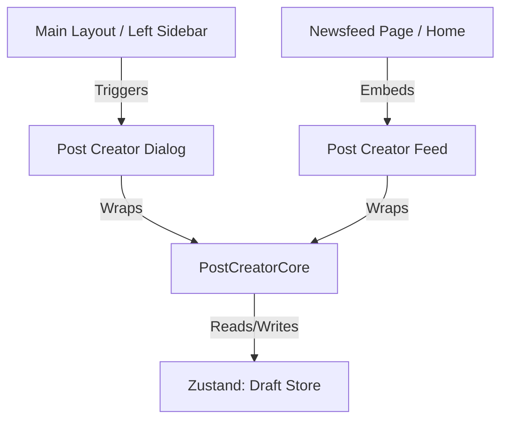

# Post Creator Specification - Dynamic Form with Drafts & Options

This specification details the implementation plan for the **Advanced Post Creator Module** in YSocial. It introduces a modular component architecture, dynamic image gallery previews with custom scroll handlers, a robust drafts management engine using Zustand, audience permissions popovers, inline mention autocomplete, and a confirmation safety net on exit.

---

## 1. Architectural Blueprint & Component Tree

To maintain a single source of truth for post creation logic, we will structure the creator module as follows:



### File Hierarchy
- `src/features/posts/types/creator.ts`: Core interfaces for draft items, media, and audience types.
- `src/features/posts/store/post-draft-store.ts`: Zustand store managing draft collections with persistent local storage mapping.
- `src/features/posts/components/post-creator-core.tsx`: Inner form engine containing state, textarea logic, image gallery, popovers, and mention listeners.
- `src/features/posts/components/post-creator-feed.tsx`: Component wrapping `PostCreatorCore` inside the home/feed container.
- `src/features/posts/components/post-creator-dialog.tsx`: Modally wrapped `PostCreatorCore` matching standard Dialog patterns.

---

## 2. Component Core State & Operations

### Text Editing & Auto-Grow
- A borderless `<textarea>` wrapped in a react-hook-form schema.
- Self-monitoring scroll height to dynamically expand height matching content lines (up to a max of `250px` before scrolling).
- character limits tracked as `content.length / 500` with visual ring or counter.

### Dynamic Image Gallery & Scrolling
- Display previews in a smooth horizontal bar: `flex flex-row gap-2 overflow-x-auto no-scrollbar w-full py-2`.
- Preview images rounded to `rounded-xl border border-zinc-150 dark:border-zinc-900 relative shrink-0 w-44 h-44 object-cover`.
- Custom scrolling handlers:
  - **Grab-Drag**: Capture `onMouseDown`, `onMouseMove`, `onMouseUp` events to scroll the element horizontally via click-and-drag.
  - **Shift-Scroll**: Capture `onWheel` events; if `e.deltaY` is detected and `Shift` is active, translate it into horizontal scroll offsets (`scrollLeft += e.deltaY`).
  - **Quick Delete**: An absolute overlay button `X` to immediately remove that image.

### Controls & Dropdown Popovers
- **Audience Selector**:
  - Located at the bottom left as a flat button displaying the active setting.
  - Opens a popover with 4 choices:
    - *Anyone* (🌐 Globe)
    - *Your followers* (👥 Users)
    - *Profiles you follow* (👤 UserCheck)
    - *Profiles you mention* (🏷️ AtSign)
- **Inline Mentions Autocomplete**:
  - Listen to key inputs in the textarea. When a user enters `@` followed by characters, show a floating popover above the cursor.
  - Displays mock user records (e.g., `anquoc.dev`, `hamy_cute`, `ysocial_member`).
  - Clicking a profile replaces the typed text with the selected `@username` and restores textarea focus.
- **GIF & Emoji Controls**:
  - Displays mini popover pickers inserting mock GIFs and emoji characters directly into the cursor position of the textarea.

---

## 3. Zustand Drafts System

A dedicated Zustand store will handle drafts, ensuring they persist across sessions using Zustand middleware:

```typescript
export interface PostDraft {
  id: string;
  content: string;
  images: string[];
  audience: "anyone" | "followers" | "following" | "mention";
  updatedAt: number;
}
```

### Store Actions:
- `saveDraft(content, images, audience, id?)`: Saves a draft, either creating a new entry or overwriting an existing draft by ID.
- `deleteDraft(id)`: Removes a draft from the collection.
- `clearDrafts()`: Empties the store.

---

## 4. Escape Interceptor & Unsaved Warning Flow

When a user tries to close the `PostCreatorDialog` (by clicking the backdrop, pressing `Escape`, or clicking "Cancel") or clear the `PostCreatorFeed` form:
- Check if `content.trim().length > 0` or `images.length > 0`.
- **Popover Escape Shield**:
  - Check if any sub-popover (Emoji picker, GIF selector, Location picker, Mentions list, Drafts manager) is open.
  - If a sub-popover is open, the `Escape` key event must only close that active popover. The main discard verification prompt will **not** trigger.
  - If all sub-popovers are closed, and there is unsaved content, **intercept the close event** and trigger an "Unsaved Changes" Confirmation Dialog with 3 options:
    1. **Save to Drafts**: Trigger `saveDraft(...)`, clear input, and close creator.
    2. **Discard**: Clear form state, delete temporary inputs, and close creator.
    3. **Cancel**: Close warning modal and restore editing focus.

---

## 5. Multi-lingual Setup (i18n Keys)

We will expand `en.json` and `vi.json` with standard keys:
- `creator.newPost`: "New post" / "Tạo bài viết"
- `creator.whatsNew`: "What's new?" / "Có gì mới thế?"
- `creator.audience`: "Who can reply" / "Ai có thể trả lời"
- `creator.anyone`: "Anyone" / "Mọi người"
- `creator.followers`: "Your followers" / "Người theo dõi bạn"
- `creator.following`: "Profiles you follow" / "Trang bạn theo dõi"
- `creator.mention`: "Profiles you mention" / "Trang được nhắc đến"
- `creator.saveDraft`: "Save to drafts" / "Lưu vào bản nháp"
- `creator.discard`: "Discard" / "Hủy bỏ"
- `creator.keepEditing`: "Keep editing" / "Tiếp tục chỉnh sửa"
- `creator.unsavedTitle`: "Discard post?" / "Hủy bài viết?"
- `creator.unsavedDesc`: "You have unsaved changes. Do you want to save this as a draft or discard it?" / "Bạn có thay đổi chưa lưu. Bạn muốn lưu thành bản nháp hay hủy bỏ?"
- `creator.drafts`: "Drafts" / "Bản nháp"
- `creator.noDrafts`: "No drafts saved" / "Chưa có bản nháp nào"
- `creator.restore`: "Restore" / "Khôi phục"
- `creator.draftSaved`: "Draft saved successfully!" / "Đã lưu bản nháp thành công!"
- `creator.draftRestored`: "Draft restored!" / "Đã khôi phục bản nháp!"
