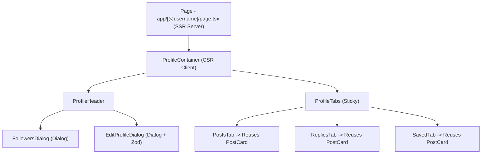

# Architecture & Visual Specification: YSocial User Profile Feature

This specification documents the technical architecture, visual rules, and data mapping strategy for the dynamic user profile page (`ysocial.app/@username`) in YSocial.

---

## 🧠 Brainstorming & Socratic Design Questions

### 1. Why dynamic routing with `[@username]`?
*   **Question**: Why name the directory `[@username]` instead of `[username]` and prefix with `@` manually?
*   **Answer**: Using `[@username]` directly maps URLs like `ysocial.app/@anquoc.dev` cleanly to the Next.js router. The folder name includes the `@` symbol so that `params` will receive the raw value `@anquoc.dev` directly. This perfectly mirrors the visual and semantic styling of Threads and X.

### 2. How to balance SEO (SSR) vs Interactivity (CSR)?
*   **Question**: Which components must be Server-Side rendered, and which must be Client-Side?
*   **Answer**: 
    *   **SSR Boundary (Server Component)**: The entry page `src/app/[@username]/page.tsx` must be a Server Component. It is responsible for parsing parameters, triggering `generateMetadata` for dynamic SEO/OpenGraph tags, fetching the user profile from the backend, and rendering initial layout bounds.
    *   **CSR Boundary (Client Component)**: The `ProfileContainer` and all sub-widgets (Header, Sticky Tabs, Edit Dialog, Followers List) must be Client Components. They manage local UI states, user interaction (tab switching, follower dialog toggling, optimistic follow updates), and call Zustand/TanStack client hooks.

### 3. How to address bio URL auto-linking securely?
*   **Question**: How can we safely parse raw bio text and inject anchor tags without opening cross-site scripting (XSS) vectors?
*   **Answer**: Instead of using dangerous React properties like `dangerouslySetInnerHTML` or loose matching, we will check protocols strictly using the standard URL constructor: `url.protocol === "http:" || url.protocol === "https:"`. Any other dynamic protocols (e.g. `javascript:`, `data:`) will be discarded and rendered as safe, plain text nodes.

### 4. How to prevent client-side time-drift hydration errors?
*   **Question**: How can we avoid Next.js hydration errors when calculation of relative time stamps (e.g., `5 mins ago`) differs slightly between the server rendering phase and client mounting phase?
*   **Answer**: We will create a `<SafeHydration>` component inside `src/components/shared/safe-hydration.tsx` that ensures time strings are only mounted once client hydration is complete, guaranteeing zero phase-mismatch errors.

---

## 🛠️ Data DTO Mapping

From `swagger.json`, the Profile update payload is structured as `UpdateProfileRequest`:
```json
{
  "displayName": "string (nullable)",
  "bio": "string (nullable)",
  "avatarUrl": "string (nullable)",
  "coverUrl": "string (nullable)",
  "gender": 0, // 0 = Unspecified, 1 = Male, 2 = Female, 3 = Other
  "dateOfBirth": "string (date-time, nullable)"
}
```

Since we need a robust dynamic query, we will define our client-side profile model `UserProfile` to mirror:
```typescript
export interface UserProfile {
  id: string;
  displayName: string;
  username: string;
  bio?: string;
  avatarUrl?: string;
  coverUrl?: string;
  followersCount: number;
  followingCount: number;
  isFollowing: boolean;
  isVerified?: boolean;
}
```

### Strict Profile Loading Behavior
- We will fetch the profile from the backend API.
- If the API returns a **404 Not Found**, we will immediately execute the Next.js `notFound()` handler to direct the user to the standard `not-found.tsx` page. We will NOT fallback to loose mock representations.

---

## 📐 Component Hierarchy & Boundaries



---

## 💅 Visual Visuals & Aesthetics (Luxury Minimalist Zinc Tone)
- **Header Structure**:
  - Name display: `text-2xl font-bold tracking-tight text-zinc-900 dark:text-zinc-50`.
  - Username label: `text-zinc-500 dark:text-zinc-400 text-sm font-medium`.
  - Avatar size: `w-20 h-20 sm:w-24 sm:h-24` with high-end border.
  - Interaction counter: `text-sm text-zinc-500 hover:underline hover:text-zinc-900 dark:hover:text-zinc-100 cursor-pointer`.
- **Sticky Tab Swapper**:
  - Border separator: Sleek border at bottom `border-b border-zinc-200/60 dark:border-zinc-900/60`.
  - Sticky offsets: Positions smoothly and remains visible on scroll.
